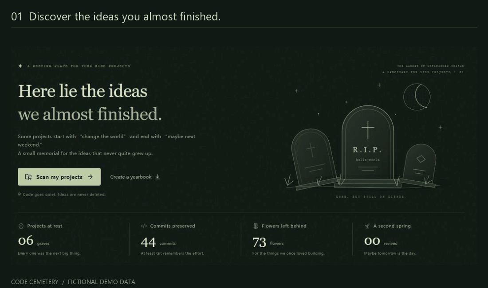

# Code Cemetery

Turn dormant local and GitHub projects into funny tombstones and shareable yearbook posters on your Windows desktop.

**[Download for Windows](https://github.com/yeze5421/code-cemetery-clean/releases/latest/download/Code-Cemetery-Windows-Setup-x64.exe)** · [Portable ZIP](https://github.com/yeze5421/code-cemetery-clean/releases/latest/download/Code-Cemetery-Windows-x64.zip) · [All releases](https://github.com/yeze5421/code-cemetery-clean/releases)



**Windows 10/11, 64-bit.** The desktop download includes its runtime and Git. No Node.js installation, terminal, browser setup, or AI API key is needed.

## Give unfinished ideas a home

- **Discover forgotten projects.** Scan a folder of local Git repositories or enter a GitHub username to find public repositories.
- **Give each project a tombstone.** Preserve its dates, commit count, and language, then add a funny, gentle, or poetic epitaph.
- **Make a yearbook.** Export a 1080px PNG poster of the projects laid to rest in a selected year.
- **Keep the last word.** Edit epitaphs, leave flowers, change the dormancy threshold, or revive a project anytime.
- **Use either language.** Switch between English and Simplified Chinese. Your own writing stays as you wrote it.
- **Extend the app.** Sources, dormancy rules, epitaph writers, and exporters have separate plugin contracts.

Dates and commit counts come from repository records. Epitaphs and causes of death are playful fiction, not factual claims about why a project stopped.

## Start in a minute

1. Download and run the **Windows installer**, then open **Code Cemetery** from your desktop. For the portable version, fully extract the ZIP and open `Code Cemetery.exe` while keeping its accompanying folders.
2. Select **Discover → Local folder → Choose folder**, choose where you keep your projects, and start the scan. The app finds Git repositories up to five directory levels deep. Folders without Git history are not detected yet.
3. Or select **GitHub repositories**, enter a username, and scan. Public repositories need no login. Add a read-only access token under **Private repositories (optional)** to scan your own private repositories, using the same account's username.
4. Open a tombstone to edit its epitaph, or use **Year in review → Create poster → Save to computer** to save a PNG.

The default dormancy threshold is 90 days. Dormancy is a signal, not a verdict: you can change the threshold or manually revive a project. Incomplete scans report warnings and retain the projects successfully read.

The GIF above uses fictional demo projects. The Windows build is currently unsigned; macOS and Linux downloads are not available.

## Your data stays on your computer

Local scanning, editing, epitaph generation, and poster export work offline. GitHub scans contact the official GitHub API. The app reads repository information; it does not modify, delete, or upload your source code.

- Desktop project records and settings are stored in your operating system's application-data directory.
- Optional GitHub tokens are stored separately with operating-system encryption. They are never included in project records or posters.
- There is no analytics service, AI service, cloud account, or hosted database in the app.
- Posters contain project names, the cemetery owner's display name, dates, counts, and your writing. Review those before sharing.

Downloads and SHA-256 checksums are available on the [release page](https://github.com/yeze5421/code-cemetery-clean/releases/latest).

## Build from source

These steps are for contributors. End users can use the Windows download above.

Install Node.js 24, then run:

```sh
npm ci --include=dev
npm run desktop
```

To build the Windows installer and portable ZIP:

```sh
npm run dist:desktop
```

Outputs go to `release/`. Dependency installation downloads Electron and the bundled Git distribution. If your package manager skips installation scripts, run `npm rebuild electron dugite` first. Keep development dependencies installed: `tsx` is also used by the optional Web service.

Validation:

```sh
npm test
npm run check
npm run build
```

## Modular architecture

| Plugin | Built-in implementation | Responsibility |
| --- | --- | --- |
| Source | `local-git`, `github` | Read repository records into a shared `Project` model |
| Detector | `dormancy` | Classify inactivity while respecting manual decisions |
| Epitaph | `epitaph` | Generate editable, deterministic English or Chinese writing |
| Exporter | `annual-png` | Render selected projects as a PNG yearbook |

The desktop shell communicates through a limited, isolated IPC bridge. It loads local application files and does not start an HTTP server. Repository scanning and credentials stay in the main process; the interface handles presentation and poster drawing.

Plugins are registered at build time. The app does not download and execute arbitrary plugin code from the internet.

Read the [architecture guide](docs/ARCHITECTURE.md), [desktop guide](docs/DESKTOP.md), and [language guide](docs/I18N.md).

## Optional Web development mode

The original local Web mode remains available for development:

```sh
npm ci --include=dev
npm run dev
```

Open `http://127.0.0.1:5173`; the local API uses port 4317. This mode needs a system Git installation for local scans. For the production Web mode, run `npm run build` followed by `npm start`, then open `http://127.0.0.1:4317`.

Optional Web-service credentials can be set in a local `.env` copied from `.env.example`, or through the `GITHUB_TOKEN` environment variable. Existing terminal variables take precedence. Desktop users configure their optional token in the app instead.

Web-mode data is stored in `.data/state.json`. The desktop app uses a separate application-data directory. GitHub Pages alone cannot run the local scanning backend.

## Repository hygiene

Commit source, tests, documentation, configuration, and the empty `.env.example`. Keep real project records, tokens, screenshots of private projects, dependencies, and build outputs out of Git. The repository's ignore rules cover these generated and local files. Publish desktop binaries as release assets rather than source commits.

## License

Original application code is released under the [MIT License](LICENSE). Bundled third-party components retain their own licenses; see [third-party notices](docs/THIRD_PARTY.md).
